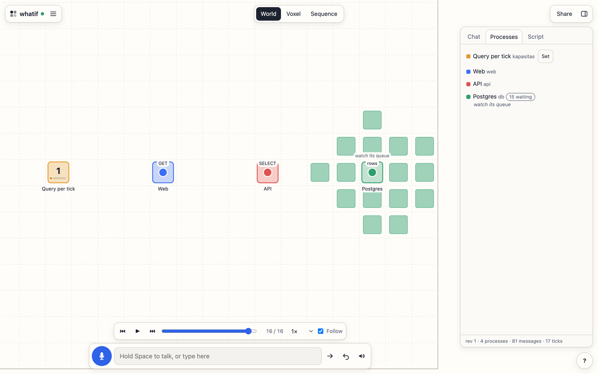
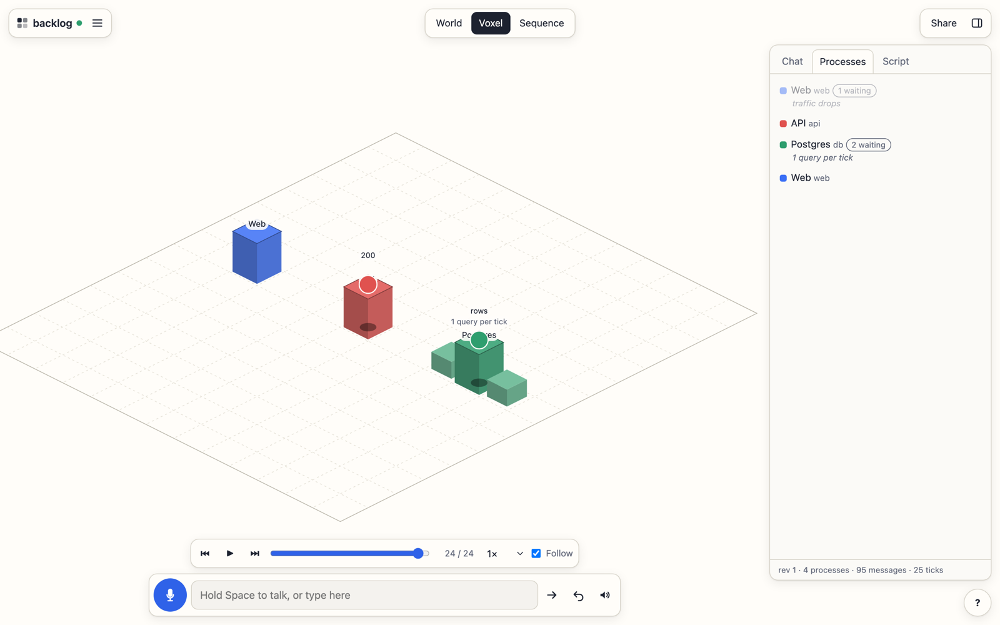
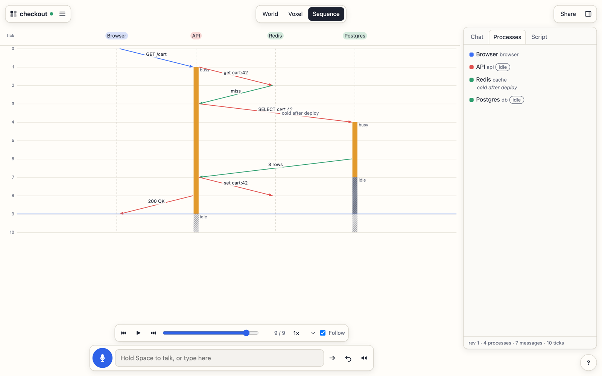
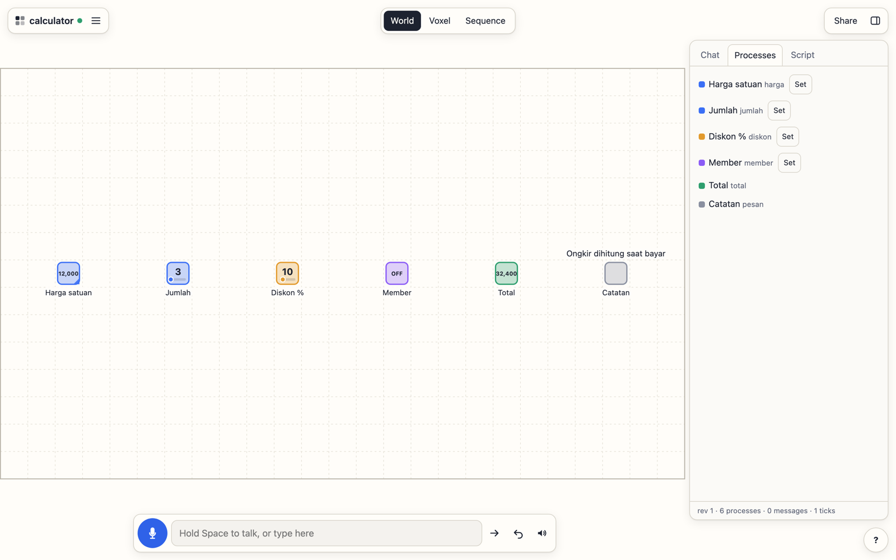
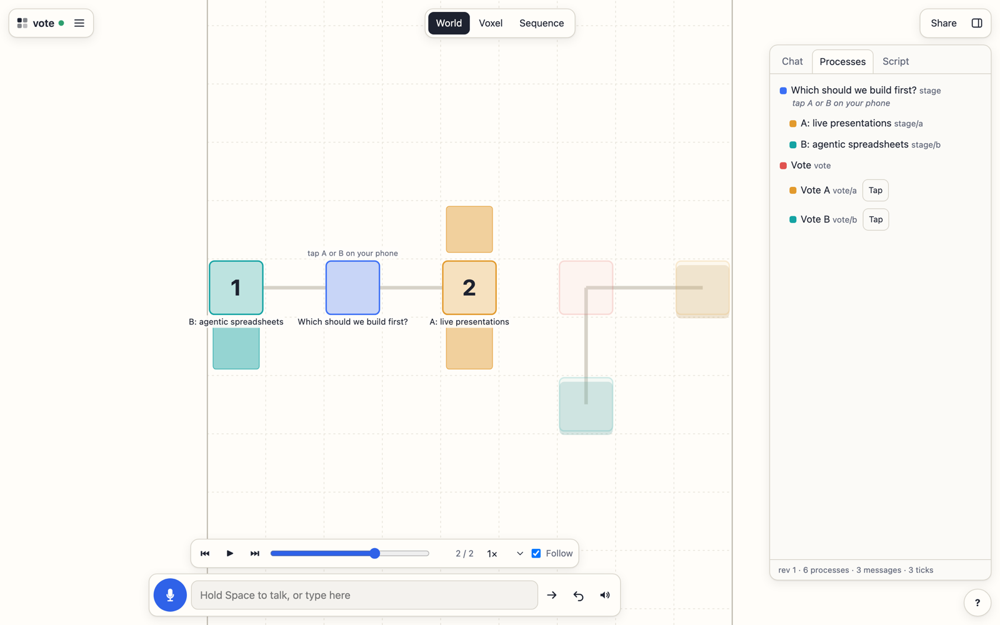

# Blockies

**Live boards that AI agents write and people watch.**

When an agent wants to show you what it means (how a request flows through a system, why a queue backs up, what happens if the database gets faster), it writes a few lines of a tiny script and hands you a link. The board runs the script, and you watch the system move.



> **Status: early, and a working name.** The Go core, the server, the MCP tools, the web viewer and the talking agent all work on your own machine. There is no hosted version and no accounts yet, so for now it runs locally only.

## The idea

A board is a small world of **processes** (little computers) that talk only by **messages**. The agent says **what** happens and never **where**: the kernel places every process, grows bodies around busy ones, and keeps everything readable. From that single run, the viewer draws three pictures:

| World | Voxel | Sequence |
|---|---|---|
| Processes on a grid, messages flying, backlogs swelling into bodies you can see | The same world in 3D (a world can have 1 to 4 axes) | Time as an axis: the run becomes a sequence diagram and a timeline. Nobody draws it |





Why a script and not a picture:

- **Agents get it right.** The language is small and closed, has no coordinates, and reports a bad line while keeping every good one, so even a long board drawn live mostly works.
- **Every run replays the same.** The kernel is pure and deterministic, so a board is the same on every screen and can be scrubbed back and forth.
- **The script is the board.** Boards are plain text: easy to diff, review and keep in git. What people do (tapping a button, moving a slider, dragging a block) is written back as lines of script too.

## Try it

You need [Go](https://go.dev/dl/) 1.27 or newer.

```bash
go install github.com/Matthew-Eucaristo/blockies/cmd/blockies@latest
```

Start the server:

```bash
blockies serve
```

In another terminal, load the examples and open one:

```bash
blockies demo
```

```bash
blockies open whatif
```

The examples:

| Board | What it shows |
|---|---|
| `checkout` | A cart request through an API, Redis and Postgres, told step by step |
| `backlog` | A burst of traffic: the database's queue grows into a body, then drains |
| `whatif` | The same, with a slider for the database's capacity: the whole run replays as you drag |
| `agent` | An agent's own work as processes and messages |
| `vote` | A live vote: people tap on their phones, the big screen counts |
| `calculator` | Blocks as live values: inputs, sliders, a toggle and formulas |
| `line` | A world with one axis |

Press `?` on a board for every shortcut. Share copies a watch-only link.

## Talk to it

Every board has a talk dock. Hold Space (or press the microphone), say what you want to see, and an agent (Claude, through the Anthropic Go SDK) draws it line by line while it answers aloud, in English or Indonesian. Say "what if the database only handles one query a second?" and watch the queue grow.

It needs Anthropic credentials on the server:

```bash
ANTHROPIC_API_KEY=... blockies serve
```

Or sign in once with `ant auth login`. `--model` and `--effort` choose the model (default `claude-opus-5-5`, low effort for quick replies). Speech recognition runs in the browser (Chrome and Safari). Elsewhere, type, or use your system's dictation.

## Connect your own agent

Claude Code, or any MCP client:

```bash
claude mcp add blockies -- blockies mcp
```

Then ask it to show you something, for example "show me how a login request flows through our services". It reads the language through MCP, writes the board and replies with a link. `blockies mcp` uses the running server, or starts one for the session.

Any agent with a shell can do the same without MCP:

```bash
blockies append demo 'proc api "API"' 'proc db "Postgres"' 'api -> db : SELECT user'
```

## The language

```
kind store color=green states=idle,busy
proc browser "Browser"
proc api "API"
proc db "Postgres" kind=store
browser -> api : GET /cart
api -> db : SELECT cart
db = busy
wait 1
db -> api : 3 rows
db = idle
api -> browser : 200 OK
```

Messages take one tick, and `&` runs a line at the same time as the one above. Rules make a board run by itself:

```
cap db 1                              # db handles one message per tick, so its queue grows
on db SELECT: db -> $from : rows      # answer every SELECT
every 2: web -> api : GET             # traffic, forever
```

Blocks can also hold live values, so a board can be a small tool:

```
proc price "Price" skin=input value 12000
proc qty "Qty" skin=slider min=1 max=50 value 3
proc total "Total" skin=number
calc total = price * qty
```



The full reference is `blockies guide` (also served at `/api/guide`, and given to agents through MCP).

## Let people take part

Blocks can be buttons. A `click` rule turns a block into something people tap, and every tap becomes a `tap` line on the board, so every screen shows the same run. Load the `vote` board: the big screen shows the result, and people open just the voting part on their phones (select it, then Menu → Copy a phone link to the selected part; the link ends in `?view=vote`).



## Safety

The server listens on 127.0.0.1 and answers only to its own host names, so other web pages cannot write to your boards. A watch link is not a password: anyone who can reach the server can open any board. To use it from phones on your network, start it with `--addr 0.0.0.0:4318 --url http://YOUR-IP:4318` (the microphone then needs HTTPS, so type or use the phone's dictation). Kernel budgets stop runaway scripts, and the server caps boards, streams and agent sessions.

## What's next

Every idea is kept here, so it can be picked up later:

- **Hosting and accounts:** a hosted service agents reach with API keys or OAuth (MCP and HTTP), returning a link the person opens. Real authentication comes first.
- **Nest:** blocks that contain whole worlds.
- **Effect ports:** blocks that call an AI or the web, with every result logged so runs still replay.
- **Sandboxed code blocks** (QuickJS or WebAssembly), **multi-field records**, and **branching edits**.
- **Local speech** with Whisper, instead of the browser's.
- **Spreadsheet-like tables** with a view of their own.
- **A usefulness test:** explain the same three real things as a plain answer, an HTML page and a board, and see which one people understand fastest. Where boards win (systems that change over time is the likely place) is where they should focus.

## Building from source

```bash
git clone https://github.com/Matthew-Eucaristo/blockies && cd blockies
```

```bash
go run ./cmd/blockies serve
```

The full check, the same as CI (gofmt, vet, golangci-lint, race tests, core purity and WebAssembly builds, viewer type check; needs Node):

```bash
scripts/check.sh
```

| Path | What |
|---|---|
| `lattice/` | A grid that never knows its dimension (rank 1 to 4) |
| `script/` | The board language: parser, formatter, formulas, guide for agents |
| `kernel/` | Runs a script into a timeline: placement, messages, rules, bodies, values. Pure and deterministic, builds for WebAssembly |
| `boards/` | The one place boards change: store, compile, fan out to viewers |
| `server/`, `mcpserver/`, `client/` | HTTP and event stream, MCP tools, HTTP client |
| `agent/` | The talking agent: Claude draws on a board while it answers |
| `web/` | The board page: plain ES modules, type-checked, embedded in the binary, no build step |
| `cmd/blockies/` | The binary |
| `examples/` | Example boards |
| `explorations/` | The eight concept sketches this design came from |

More: [docs/architecture.md](docs/architecture.md) and [docs/decisions.md](docs/decisions.md). The earlier Rust version is tagged `rust-final`.

## Credits

Co-created by Matthew and Edward Manhattan (original idea).

No license has been chosen yet, so all rights are reserved for now.
